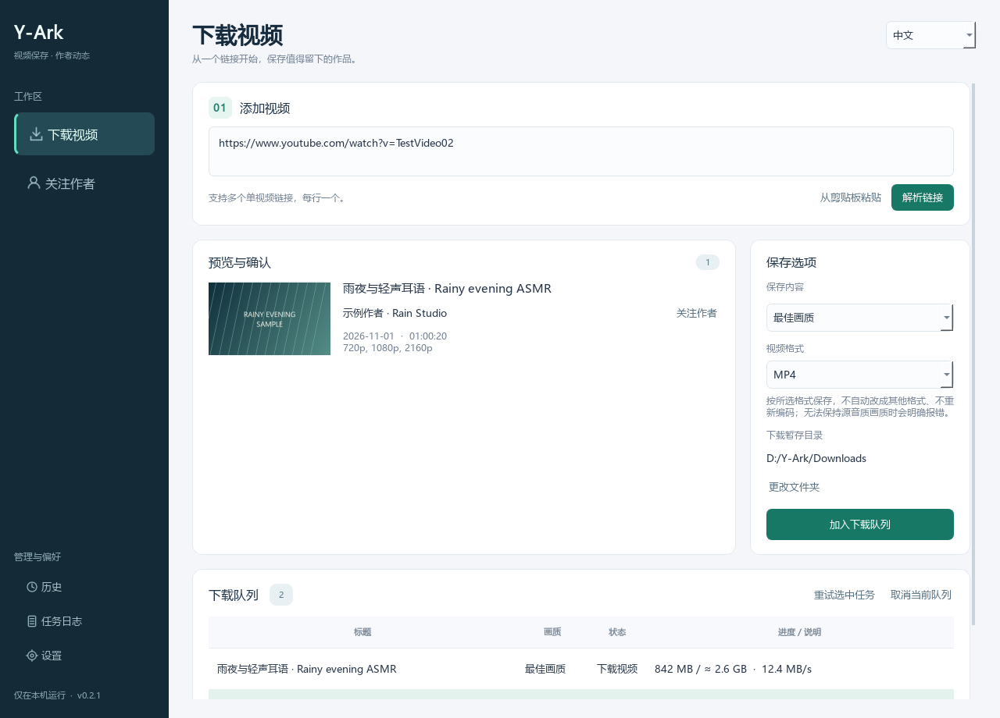
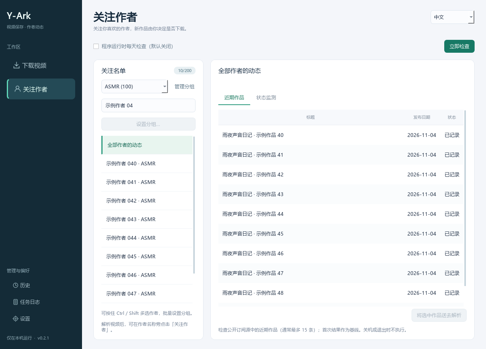

# Y-Ark

**Windows 本地 YouTube 保存工具 · v0.2.1**

Windows 本地 YouTube 保存工具。支持中文 / English / 日本語，主工作区为下载视频和关注作者。

名称灵感来自《数码宝贝驯兽师之王》（第三部）的 D-Ark。Y-Ark 是独立个人项目，与原作及权利方没有关联；项目未使用原作图像、标志或素材。



## 安装与打开

当前发布为**源码版**，不是双击即用的独立 EXE。支持 Windows，需先安装：

- [Python 3.11 或更新版本](https://www.python.org/downloads/windows/)，安装时启用 Python Launcher。
- [FFmpeg](https://ffmpeg.org/download.html)（包含 `ffmpeg` 和 `ffprobe`），加入 PATH。
- [Deno](https://docs.deno.com/runtime/getting_started/installation/)，加入 PATH，供 yt-dlp 的 YouTube 支持使用。

从 [Releases](https://github.com/Qiankunyi/Y-Ark/releases) 下载源码 ZIP，解压到可写目录，运行 `Setup-Y-Ark.cmd` 安装 Python 依赖，再双击 `Start-Y-Ark.cmd`。首次安装需要网络。设置中的依赖检查可以确认外部工具是否可用。

## 下载

1. 粘贴一个或多个单视频链接，每行一个，点击解析。
2. 确认标题、封面和作者，选择最佳画质 / 最高 1080p / 最高 720p / 仅音频。
3. 视频独立选择 **MP4 或 MKV**，音频独立选择 **保留原音质或 MP3**。
4. 确认暂存目录，加入下载队列；完成后可自行移动视频、JPG 和 JSON。

设置中可选择暂存目录和 Deno 可执行文件。遇到明确登录要求时，再选择自己的本地 Cookie 文件；程序只保存路径。不要将 Cookie 或个人数据提交到 GitHub。

## 统一保存规则

画质和保存容器彼此独立：选择 1080p 不会自动把 MP4 改成 MKV。默认 MP4，也可明确选择 MKV。视频按原编码重新封装，不静默转码、降质或切换容器；如果所选容器无法承载源音视频，任务会报告原因，并保留工作文件。

全部下载预设和本地另存共用同一交付校验：

- 验证真实音频、视频轨道和有效时长；视频不能超过所选分辨率上限。
- 封面写入文件后读回，与独立原 JPG 字节比较。
- 检查实际容器与所选格式一致。
- 所有检查通过才交付成品并写入成功历史。封面写入或校验失败不再当作成功交付。
- 目标同名文件不覆盖，交付中发生错误会回滚本次创建的目标文件。

MKV 使用标准封面附件，MP4 使用附加封面图轨道。系统和播放器对这两种封面的预览支持不同；文件内含封面不等于所有资源管理器都显示缩略图。完成结果会显示实际格式、分辨率和“封面已验证”。

新视频文件在视频 ID 前包含格式标记，例如 `(1080p MP4) [视频ID].mp4`，并使用同名 JPG / JSON，让多种画质、格式与旧成果可区分。每个任务保存自己的格式选择；重试及重启会沿用原任务选项。更换格式可重新加入队列，或使用历史页的本地另存。

## 已有文件另存

历史页选择已有文件：

- **视频另存为…**：选择 MP4 / MKV 和输出目录，无重新编码，重新写入并校验封面。
- **音频另存为 MP3…**：读取本地音频，不重新下载，生成 MP3、JPG 和 JSON。

两项都保留原文件。旧路径不存在时只提示文件可能已移动，成功历史仍保留。

## 音频格式

- **保留原音质**：不重新编码。Opus 从 WebM 封装为 `.opus`，AAC 保持 `.m4a`，并嵌入封面。
- **MP3（320 kbps）**：使用最高可用源音频重新编码，写入 ID3v2.3 封面及可得的标题、作者；转换不能提高源音质。

## 作者分组和搜索

关注页支持自定义分组、新建、重命名及删除。每位作者可属于多个分组。

1. 点击“管理分组”创建自己的分组。
2. 选择一位作者，或按住 Ctrl / Shift 选择多位，点击“设置分组…”。
3. 勾选分组后确认；半选表示一部分作者已在该组，保持半选不会改变原归属。
4. 用“全部分组 / 未分组 / 自定义组”筛选，再输入作者名或频道 ID 搜索。两种筛选会同时生效。

删除分组不会删除关注作者或视频。作者改名仍按频道 ID 识别，不产生重复关注，也不会丢失分组。

关注不会自动下载。公开 RSS 通常提供最近 15 条，首次检查建立基线；发现作品后由用户送去解析。可选在应用持续运行时每 24 小时检查，关闭时不执行。网络错误不会自动判定视频已删除。

## 验证与边界

自动测试覆盖三个视频画质、MP4/MKV 两个容器、H.264/AAC、VP9/Opus、AV1/Opus 三组编码共 18 组输出，另覆盖音频、封面替换、错误封面拒绝、任务选项恢复、老数据库迁移、150～200 作者分组搜索及批量归属。

测试方法与限制见 [TESTING.md](docs/TESTING.md)。

仍需进一步验收：新版本在真实网络下的大视频完整下载及中断恢复、PotPlayer 和 Windows 预览表现、新电脑安装包和持续 24 小时检查。

成功后仍保留 `.creatorsave` 工作文件，会额外占用磁盘；取消在网络解析阶段可能需要等待当前请求结束。交付时被强制结束进程可能遗留部分成果或 `.creatorsave-part` 文件，程序不会覆盖它们，需先核对。

新安装的数据位于 `%LOCALAPPDATA%\Y-Ark`；检测到旧版 `%LOCALAPPDATA%\CreatorSave` 时继续使用旧目录，历史、分组与设置保留。旧启动文件仍可用。内部模块和工作目录暂时保留原名以兼容既有任务。不扫描或管理最终收藏目录。设置、历史、分组和日志不随源码发布。

## 开发与测试

安装上述依赖后：

```powershell
python -m venv .venv
.\.venv\Scripts\python -m pip install -e .
.\.venv\Scripts\python -m creatorsave.app
New-Item -ItemType Directory -Force .tmp
.\.venv\Scripts\python -m unittest discover -s tests -v
```

[yt-dlp 官方依赖说明](https://github.com/yt-dlp/yt-dlp#dependencies) · [FFmpeg](https://ffmpeg.org/download.html) · [Deno](https://deno.com/)

仅保存自己拥有、获授权或法律允许下载的内容。解析下载由 yt-dlp 提供；Y-Ark 实现交互、任务与历史、统一校验及关注管理。

## 更新与反馈

后续版本在同一仓库的 Releases 发布。更新步骤见 [RELEASING.md](docs/RELEASING.md)，问题可提交到 [Issues](https://github.com/Qiankunyi/Y-Ark/issues)。当前没有自动升级。



本仓库目前未指定开源许可证；公开可见不代表授予额外的再分发或修改许可。第三方依赖遵循各自许可证。
