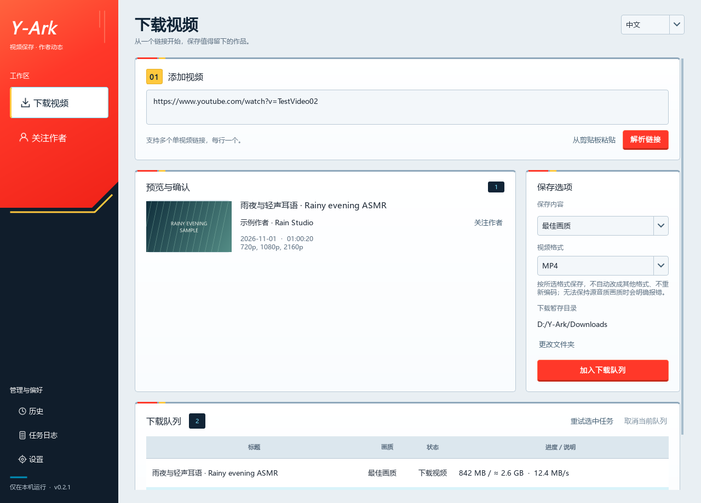
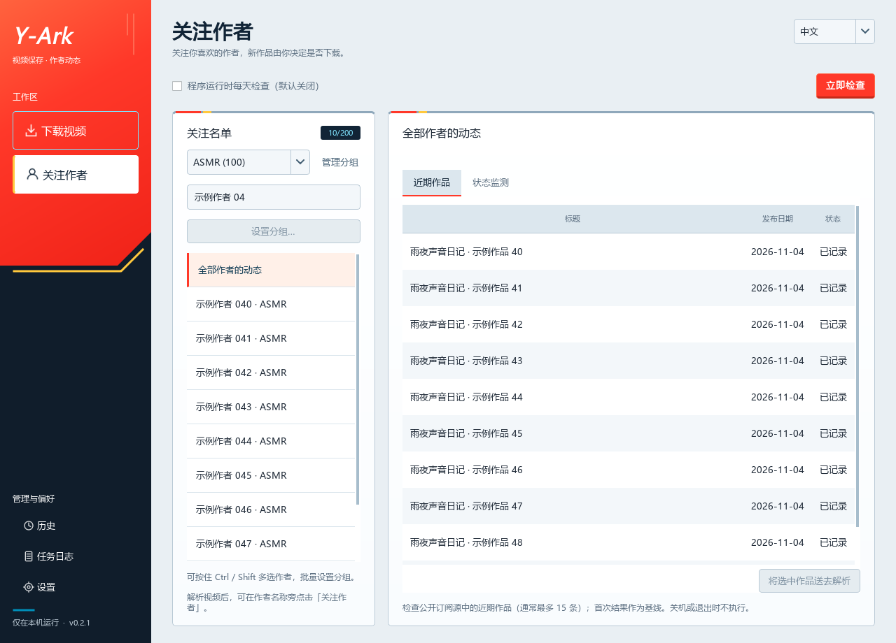

# 葛拉尼 · Ignition

保留原有工作区结构，以葛拉尼和红莲骑士兽为灵感，使用鲜亮朱红的装甲外壳、银白面板、亮金接缝和冰蓝指示。参考 [葛拉尼外观](https://digimon.fandom.com/wiki/Grani_%28Tamers%29) 和 [万代 D-Ark 资料](https://p-bandai.jp/item/item-1000104511/)，不使用角色图像或标志。

## 视觉语言

| 元素 | 色值 / 处理 | 用途 |
| --- | --- | --- |
| 鲜亮朱红 | `#FF3829` | 主按钮、侧栏外壳、边缘嵌条 |
| 外壳高光 | `#FF633E` | 侧栏轻微定向渐变 |
| 亮金 | `#FFC83D` | 斜切接缝、步骤编号、选中标记 |
| 深海军黑 | `#101D2B` | 侧栏下半部 |
| 银白 | `#E9EFF3` / `#FFFFFF` | 工作区与面板 |
| 冰蓝 | `#80E4FF` | 深底计数器文字 |
| 焦点蓝 | `#008EB8` | 输入及键盘焦点 |
| 深墨蓝 | `#202B38` | 正文 |

侧栏采用斜切红色外壳，金色线条沿切口延伸。当前导航切换为银白色块及深色图标。面板缩小圆角，使用银色顶边、红金嵌条和轻微白色渐变。主按钮使用鲜红平面与较深的下沿。下拉箭头使用应用内 SVG，替换原有系统立体边框。颜色表达来自角色设计，页面结构与 YouTube 保存工具的操作流程保持一致。

成功、警告、错误继续通过状态文字和独立底色区分。亮红采用视觉优先的高饱和方案：白字对主红的对比度约 3.59:1，未达到普通字号文字 4.5:1 的 AA 门槛。正文对白底约 14.34:1，次要文字对白底约 5.42:1，深字对亮金约 10.22:1；这些数值不代表应用经过完整无障碍认证。

## 实现与验证

`creatorsave/theme.py` 管理颜色、QSS 和 Qt 调色板。`creatorsave/ui.py` 中的 `ArmorSidebar` 和 `ArmorCard` 绘制外壳及接缝，不增加操作步骤。`creatorsave/assets/chevron-down.svg` 随 Python 包一起交付。

截图使用独立临时数据库和模拟内容，覆盖中文、英文、日文、1120×800 紧凑窗口、设置和分组弹窗。现有 GUI、作者分组/保存选项 GUI 和解析反馈测试共 17 项通过，wheel 构建通过并包含下拉箭头资源。下载引擎与数据格式未修改。

